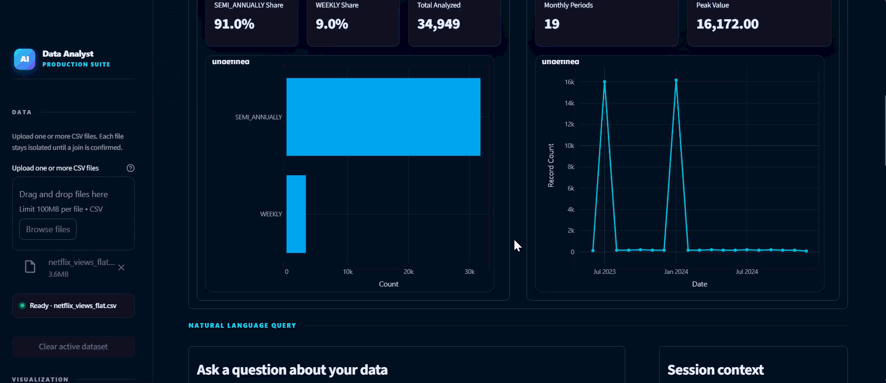
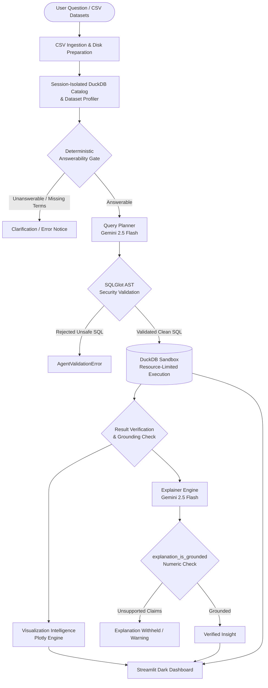
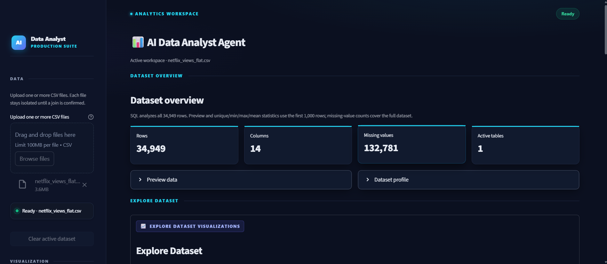
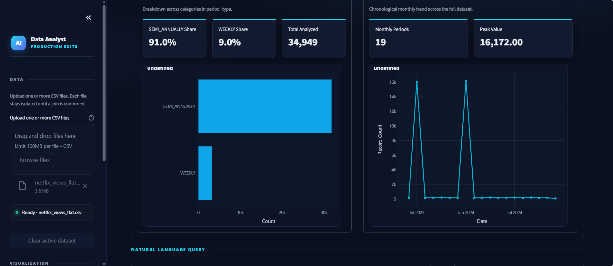
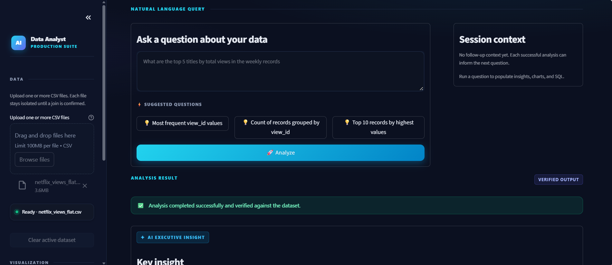

# 🤖 AI Data Analyst Agent

[](https://www.python.org/)
[](https://streamlit.io/)
[](https://duckdb.org/)
[](https://ai.google.dev/)
[](https://github.com/tobymao/sqlglot)
[](LICENSE)

## 🎬 Project Demo

Watch the AI Data Analyst Agent analyze datasets, generate insights, and create interactive visualizations.



An enterprise-ready, autonomous AI Data Analyst Agent built with **Google Gemini**, **DuckDB**, **SQLGlot**, and **Streamlit**. The system converts plain-English analytical questions into optimized DuckDB SQL, verifies queries against an Abstract Syntax Tree (AST) security layer, executes them in a sandboxed SQL engine, validates narrative numbers against actual execution outputs, and renders interactive dark-themed charts and data tables.

Repository: [https://github.com/Srijan915/Ai-Data-Analyst-Agent](https://github.com/Srijan915/Ai-Data-Analyst-Agent)

---

## 📌 Project Overview

Traditional conversational analytics systems often suffer from two major flaws: **security risks** from running unvalidated AI-generated SQL directly on databases, and **AI hallucinations** where the LLM invents metrics and numbers that contradict actual query results.

This AI Data Analyst Agent solves both challenges through an engineered defense-in-depth pipeline:
1. **Isolated Responsibilities**: The LLM *never* interacts directly with the database; it only proposes SQL syntax.
2. **AST-Level Security Validation**: Every proposed query is parsed into an Abstract Syntax Tree via **SQLGlot** and strictly validated against security rules (read-only enforcement, allowlisted tables, banned functions, row limits).
3. **Deterministic Answerability & Grounding**: Natural language queries are checked prior to LLM submission (`assess_answerability`), and generated AI explanations are validated against the actual DuckDB result set (`explanation_is_grounded`) to withhold any unsupported numeric claims.
4. **Session-Private Multi-Dataset Catalog**: Upload single or multiple CSVs into an isolated DuckDB database with automatic relationship detection and explicit human-in-the-loop join confirmation.
5. **Modern Visualization Studio**: Automatically derives insights and renders interactive Plotly figures (bar, grouped bar, donut/pie, line, histogram, scatter) alongside raw result data.

---

## 🏗️ System Architecture & Data Flow



### Architectural Separation of Concerns
- **LLM Boundary**: Google Gemini translates intent into query syntax; it has no database access, network sockets, or filesystem permissions.
- **Security Boundary**: SQLGlot independently evaluates syntax trees before DuckDB receives any statements.
- **Database Sandbox**: DuckDB runs with `enable_external_access=false`, strict RAM limits, thread caps, and timeout constraints.
- **Grounding Boundary**: Narrative AI summaries are parsed for numbers, percentages, and financial metrics; any claim not found in the SQL result set is withheld.

---

## ✨ Key Features

### 📊 Multi-Dataset Management & Relationship Engine
- **Session-Private DuckDB Catalog**: Upload one or more CSV files into an ephemeral DuckDB database (`DatasetCatalog`).
- **Sanitized Table Names**: Safe, collision-resistant table identifiers (`ds_<stem>_<hash>`) prevent SQL injection and naming conflicts.
- **Relationship Discovery**: Detects shared columns, matching inferred types, and calculates exact value overlap percentages between tables.
- **Human-in-the-Loop Joins**: Multi-table queries require explicit user confirmation of detected relationships before joins can be planned, eliminating hallucinated or cross-product joins.

### 🧠 Gemini-Powered Natural Language Analysis
- **Schema-Aware Query Planning**: Powered by Google's `gemini-2.5-flash`, the planner receives clean column profiles, data types, and sample distributions.
- **Conversational Context**: Supports follow-up questions within the active session, retaining up to three previous question-and-SQL turns.
- **Complex Data Normalization**: Intelligently handles messy real-world formats including currency symbols (`$`, `€`), comma thousand-separators, percentages, and ISO/US calendar dates.

### 🛡️ Multi-Layer SQL Security Validation
- **AST Parsing**: SQLGlot inspects the query syntax tree rather than relying on brittle regex matching.
- **Read-Only Enforcement**: Blocks `INSERT`, `UPDATE`, `DELETE`, `DROP`, `ALTER`, `CREATE`, `PRAGMA`, `COPY`, and file exports.
- **Function Whitelist**: Only authorized aggregate and mathematical functions are permitted; malicious functions like `system()`, `read_csv()`, or `read_parquet()` are strictly blocked.
- **Enforced Row Limits**: Automatically verifies or injects query output limits (`LIMIT 10000`).

### 🔍 Numeric Grounding & Hallucination Defense
- **Automated Verification**: The `explanation_is_grounded` module extracts every numeric claim, percentage, currency figure, and multiplier (K, M, B) from the AI-written summary.
- **Data Cross-Check**: Every claim is cross-referenced with values present in the query result dataframe and row count.
- **Suppression Mechanism**: If an explanation makes unverified numeric assertions, the explanation is suppressed and replaced with a transparent warning.

### 🎨 Dark-Themed Streamlit Analytics Dashboard
- **Custom CSS Design**: Styled with a tailored modern dark theme, status indicator chips, and responsive containers.
- **Automated Dataset Insights**: Instant high-level summary cards (rows, columns, memory, missing values) and automatically generated initial charts upon upload.
- **Interactive Visualizer Studio**: Direct dataset charting allowing users to build custom visuals independent of AI queries:
  - **Bar Charts**: Vertical and horizontal orientations with custom aggregations (Sum, Mean, Median, Max, Min).
  - **Grouped Bar Charts**: Compare multiple numeric metrics across categorical groups.
  - **Donut / Pie Charts**: Proportional distributions with configurable slice limits.
  - **Line Charts**: Time-series or sequential tracking with optional multi-series color grouping.
  - **Histograms**: Continuous variable distributions with optional marginal box plots.
  - **Scatter Plots**: Two-variable numeric correlation analysis with optional categorical color dimensions.
- **Contextual Suggested Prompts**: Dynamic suggestions derived from the active dataset's numeric and categorical schema to jumpstart analysis.
- **Rich Result Display**: Execution runtimes, formatted SQL query inspector, interactive dataframe tables, and generated Plotly figures.

---

## 🛠️ Technology Stack

| Layer | Technology | Version | Purpose |
| :--- | :--- | :--- | :--- |
| **Language** | Python | `3.11+ / 3.13` | Application runtime |
| **Web UI** | Streamlit | `1.54.0` | Dark-themed interactive web dashboard & state management |
| **AI / LLM** | Google GenAI SDK | `2.33.0` | Gemini 2.5 Flash query planning & narrative explanation |
| **Database** | DuckDB | `1.3.2` | High-performance in-process analytical SQL database & session catalog |
| **SQL Security** | SQLGlot | `27.14.0` | Abstract Syntax Tree (AST) parsing & security validation |
| **Data Processing** | Pandas | `2.3.2` | Data loading, manipulation, and schema profiling |
| **Visualizations** | Plotly | `6.3.0` | Dark-themed responsive charts (bar, grouped bar, pie/donut, line, histogram, scatter) |
| **Schema Validation**| Pydantic | `2.12.5` | Type-safe structured models & schemas |
| **Configuration** | Python-dotenv | `1.2.2` | Environment variable management |
| **Network & SSL** | Truststore / HTTPX | `0.10.5` | Enterprise and platform TLS root certificate verification |
| **Test Suite** | Pytest & Pytest-Cov | `9.0.3` / `7.1.0` | Unit, integration, security, and offline benchmark testing |

---

## 📁 Project Structure

```text
ai-data-analyst-agent/
├── .github/                     # CI/CD workflows and automated checks
├── .streamlit/                  # Streamlit server & UI configuration
├── app/
│   ├── core/                    # Core business logic & pipeline orchestration
│   │   ├── agent.py             # Main DataAnalystAgent pipeline orchestrator
│   │   ├── answerability.py     # Pre-LLM deterministic answerability gate
│   │   ├── chart_generator.py   # Plotly chart generation & automated dataset visuals
│   │   ├── dataset_catalog.py   # Multi-dataset DuckDB catalog & relationship engine
│   │   ├── data_loader.py       # Safe CSV loading, encoding checks & size validation
│   │   ├── data_profiler.py     # Schema inspection & column profiling
│   │   ├── disk_dataset.py      # Disk-backed dataset storage for large files
│   │   ├── execution_preparation.py # Canonical type and date normalization
│   │   ├── explainer.py         # Gemini-powered natural-language explanation
│   │   ├── llm_client.py        # Gemini client adapter with timeout & quota budgets
│   │   ├── query_planner.py     # Natural language to DuckDB SQL planning
│   │   ├── result_verifier.py   # Result integrity checks & numeric grounding validation
│   │   ├── semantic_checks.py   # Data fidelity verification
│   │   └── sql_executor.py      # Sandboxed DuckDB execution engine
│   ├── models/
│   │   └── schemas.py           # Pydantic data models & state structures
│   ├── prompts/
│   │   └── query_planner.py     # Schema-grounded prompt templates for Gemini
│   ├── ui/
│   │   ├── analysis.py          # Streamlit analysis execution & rendering helpers
│   │   └── styles.css           # Workspace dark analytics stylesheet
│   ├── utils/
│   │   ├── analysis_capacity.py # Concurrency limiters
│   │   ├── dataset_resources.py # Dataset memory & row budget guards
│   │   ├── logger.py            # Structured logging utilities
│   │   ├── prompt_budget.py     # Token and prompt character length budgeting
│   │   ├── request_budget.py    # Hourly LLM rate-limiting
│   │   ├── security.py          # SQLGlot AST validation & SQL safety rules
│   │   └── temporary_storage.py # Safe session temp directory management
│   ├── config.py                # Centralized, immutable typed application configuration
│   └── main.py                  # Streamlit application entry point
├── data/
│   └── sample/                  # Optional sample datasets for local testing
├── docs/                        # Project documentation & visual assets
├── scripts/                     # Operational checks & verification scripts
├── tests/                       # Comprehensive automated test suite
│   ├── fixtures/                # Offline benchmark datasets & test cases
│   └── test_*.py                # Component, security, and integration tests
├── .env.example                 # Example environment variables template
├── OPERATIONS.md                # Operational guidelines & runbook
├── pytest.ini                   # Pytest configuration
├── requirements.txt             # Pinned project dependencies
└── README.md                    # Project documentation
```

---

## 📷 Application Screenshots

The following screenshots showcase the current AI Data Analyst Agent dashboard and its analytics workflow.

### 1. Dashboard & Dataset Overview

View dataset dimensions, missing-value statistics, and the active analysis workspace.



### 2. Automated Dataset Visualizations

Explore automatically generated charts and dataset-level insights.



### 3. Natural Language Query & AI Analysis

Ask analytical questions in plain English and inspect the resulting insights and verified output.




---

## 💻 Installation & Setup (Windows)

### Prerequisites
- **Python 3.11** or **Python 3.13** installed on your system.
- **Git** command-line tools.
- A **Google Gemini API Key** (obtainable from [Google AI Studio](https://aistudio.google.com/)).

### 1. Clone the Repository
Open PowerShell and clone the project:
```powershell
git clone https://github.com/Srijan915/Ai-Data-Analyst-Agent.git
cd Ai-Data-Analyst-Agent
```

### 2. Create and Activate a Virtual Environment
```powershell
python -m venv .venv
.\.venv\Scripts\Activate.ps1
```

*(If script execution is disabled in PowerShell, run `Set-ExecutionPolicy -Scope Process -ExecutionPolicy Bypass` first).*

### 3. Install Dependencies
Install all required pinned packages:
```powershell
pip install -r requirements.txt
```

### 4. Configure Environment Variables
Copy the example environment template to `.env`:
```powershell
Copy-Item .env.example .env
```

Open `.env` in your editor and configure your Gemini API key:
```dotenv
# Required for natural-language query planning and explanations
GEMINI_API_KEY=your_actual_gemini_api_key_here

# Language Model Configuration
LLM_PROVIDER=gemini
LLM_MODEL_ID=gemini-2.5-flash
LLM_CONNECT_TIMEOUT_SECONDS=5
LLM_READ_TIMEOUT_SECONDS=45

# Application Environment
APP_ENV=development
LOG_LEVEL=INFO

# Optional access gate for shared/hosted demos (leave blank for local dev)
APP_ACCESS_PASSWORD=
```

> [!WARNING]
> Never commit your `.env` file or expose your API keys. The `.env` file is explicitly ignored in `.gitignore`.

### 5. Run the Application
Launch the Streamlit web dashboard:
```powershell
streamlit run app/main.py
```

The application will start locally at `http://localhost:8501`.

---

## ⚙️ Configuration Reference

All settings can be configured via environment variables or your local `.env` file:

| Variable | Default | Description |
| :--- | :--- | :--- |
| `GEMINI_API_KEY` | *(Required)* | Google Gemini API key for query planning and explanation. |
| `LLM_PROVIDER` | `gemini` | Language model provider adapter. |
| `LLM_MODEL_ID` | `gemini-2.5-flash` | Gemini model identifier used for analysis. |
| `LLM_CONNECT_TIMEOUT_SECONDS` | `5` | Network connection timeout for Gemini API calls. |
| `LLM_READ_TIMEOUT_SECONDS` | `45` | Response read timeout for Gemini API calls. |
| `APP_ENV` | `development` | Runtime environment (`development` or `production`). |
| `APP_ACCESS_PASSWORD` | *(Empty)* | Optional access password gate for shared deployments. |
| `MAX_UPLOAD_SIZE_MB` | `100` | Maximum allowed size per uploaded CSV file. |
| `MAX_DATASET_ROWS` | `100000` | Maximum rows retained in standard pandas memory mode. |
| `MAX_DISK_DATASET_ROWS` | `2000000` | Maximum rows allowed for large datasets using disk-backed DuckDB. |
| `MAX_QUERY_RESULT_ROWS` | `10000` | Hard cap on rows returned by SQL query execution. |
| `QUERY_TIMEOUT_SECONDS` | `30` | Timeout for DuckDB SQL query execution. |
| `MAX_CONCURRENT_ANALYSES` | `1` | Maximum simultaneous analyses per application process. |
| `MAX_LLM_REQUESTS_PER_HOUR` | `60` | Rolling hourly quota budget for Gemini API requests. |
| `DUCKDB_MEMORY_LIMIT` | `512MB` | DuckDB execution memory limit ceiling. |
| `DUCKDB_THREAD_LIMIT` | `2` | DuckDB worker thread limit ceiling. |

---

## 🗄️ Multi-Dataset Behavior & Limitations

### How Multi-Dataset Analysis Works
1. **Isolated DuckDB Materialization**: When you upload multiple CSVs, each file is ingested and converted into an isolated table inside a session-private DuckDB database (`catalog.duckdb`).
2. **Safe Namespacing**: Filenames are sanitized into deterministic identifiers (e.g., `ds_sales_data_a1b2c3d4e5`), preventing SQL injection via crafted filenames.
3. **Automatic Relationship Inference**: The catalog scans uploaded tables for:
   - Matching column names (case-insensitive).
   - Compatible inferred types (e.g., `integer` to `integer`).
   - Value overlap percentages calculated using distinct sets.
4. **Human-in-the-Loop Join Confirmation**:
   - Relationship suggestions **never** authorize joins automatically.
   - You must review and confirm suggestions in the sidebar.
   - If a user asks a query requiring a join on an unconfirmed relationship, the pre-LLM gate (`assess_answerability`) pauses execution and requests confirmation.

### Current Limitations
- **CSV Support Only**: Multi-dataset management currently supports CSV format (Excel `.xlsx` and direct SQL connections are not supported).
- **Session-Private Lifecycle**: Catalogs are ephemeral and bounded to your browser session. Clearing the dataset removes all temporary tables and DuckDB files from disk.
- **Resource Limits**: Ingestion and catalog sizes are constrained by configured memory (`MAX_TOTAL_DATASET_MEMORY_MB`) and disk (`MAX_TOTAL_DATASET_DISK_MB`) budgets.

---

## 🧪 Testing & Verification

The repository includes a comprehensive automated test suite covering all critical components:

```powershell
# Run the entire test suite
pytest -q

# Run with test coverage reporting
pytest --cov=app --cov-report=term-missing
```

### Test Scope
- **SQL Security & AST**: Verifies that SQL injection attempts, unauthorized table names, data-modifying queries (DML/DDL), and forbidden functions are rejected.
- **Grounding Validation**: Tests numeric extraction and ensures explanations containing numbers absent from query outputs are withheld.
- **Catalog & Relationships**: Validates multi-dataset materialization, collision handling, and relationship overlap logic.
- **Deterministic Offline Benchmark**: Runs fixed fixtures without network calls or API keys to verify parsing and safety rules:
  ```powershell
  python -c "from app.core.offline_benchmark import run_offline_benchmark; print(run_offline_benchmark())"
  ```

---

## 📄 License

This project is licensed under the **MIT License** — see the [LICENSE](LICENSE) file for details.
