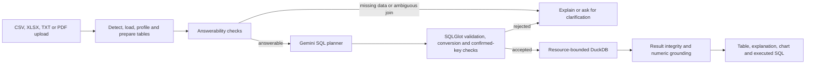

# Architecture and analysis workflow

The application answers questions about uploaded table data through a Streamlit
interface. Gemini proposes SQL; the application decides whether that SQL can
run, executes it with DuckDB, and displays the result and the SQL actually sent
to DuckDB. The workflow uses deterministic checks at several boundaries, but
does not prove that a safe query correctly expresses the user's intent.

## From upload to answer

1. `app/main.py` accepts CSV, XLSX, TXT and PDF uploads and manages Streamlit session
   state. `app/file_handlers/` detects signatures, reads selected Excel sheets
   as separate text-valued tables, distinguishes delimited TXT from document
   text, and extracts PDF tables by page. PDF page text remains a document;
   page failures are listed while later pages continue. Image-only PDFs show an
   OCR limitation. Documents stay in session state and do not become SQL tables.
   Standard CSVs retain their existing loading route; parsed tables enter the
   existing catalog through normalized CSV bytes. `app/core/data_loader.py`
   checks CSV inputs and size limits; `data_profiler.py`
   builds column information and bounded samples. `execution_preparation.py`
   prepares types for SQL while protecting values that cannot be converted
   losslessly. Large uploads use `disk_dataset.py`; multiple uploads use the
   session catalog in `dataset_catalog.py`.
2. `app/core/answerability.py` uses schema and question heuristics to flag
   common missing-data requests, ambiguous questions, and unconfirmed joins.
   This is a first-pass check, not a general semantic understanding system.
   The gate can detect explicit unconfirmed join requests before a provider call.
   Generated SQL is checked independently, so omitting the word 'join' does not
   bypass relationship authorization.
3. `app/core/query_planner.py` supplies the model with the question, bounded
   profile, all catalog schemas and relationship statuses, and up to three earlier
   validated question/SQL turns. Catalog prompts use the registered physical
   table names instead of the single-CSV `dataset` example. The agent refreshes
   the catalog profile for every analysis, including after confirmations. The Gemini
   adapter in `llm_client.py` applies request budgets, timeouts, and typed
   provider errors. A bounded correction may be requested after malformed SQL.
4. `app/utils/security.py` parses SQL with SQLGlot and checks its AST, allowed
   table references and functions, read-only restrictions, and row limits.
   `app/core/semantic_checks.py` checks applicable single-dataset conversions for
   potential loss of meaning or precision. Catalog tables are prepared at upload;
   the same per-query conversion check is not applied to catalog queries.
   `app/core/join_validation.py` separately resolves qualified join columns through
   SQLGlot scopes and direct CTE projections to physical table/column pairs.
   Every join predicate must use an exact confirmed relationship, connecting the
   newly introduced source to an earlier source. Unsupported lineage fails closed.
   Both `agent.py` and `CatalogSQLExecutor.execute` enforce this boundary; the
   executor rechecks current status so a revoked relationship cannot reuse an
   earlier validation result.
5. `app/core/sql_executor.py` and the disk/catalog executors run validated SQL
   in DuckDB with external access disabled and configured resource controls.
   `agent.py` orchestrates the stages and releases resources. Empty and truncated
   results produce warnings; the UI shows the validated SQL including the
   enforced limit when present.
6. `result_verifier.py` checks result metadata and compares recognized numeric
   explanation claims with returned values and row count. Unsupported numeric
   claims cause the explanation to be withheld. This heuristic does not prove
   nonnumeric claims or the semantic correctness of the query. `chart_generator.py`
   and `app/ui/analysis.py` produce charts and present results; a failed chart
   or explanation does not erase an otherwise successful SQL result.

## Data and session boundaries

Files and temporary query storage are managed per session, with configured
memory, disk, row, concurrency, and timeout limits. Clearing the active dataset
releases its associated temporary resources. Dataset profiles and samples,
questions and bounded follow-up history are included in planning prompts;
bounded query result rows and SQL are included in explanation prompts. These
requests go to Gemini, so the application is not fully local. Consult
[OPERATIONS.md](../OPERATIONS.md) before sharing a deployment.

## Evaluation design

`evals/questions.json` contains 60 reviewed questions: 45 answerable cases
with gold SQL and 15 unanswerable cases. `evals/validate_questions.py` executes
all 45 gold queries against the sample. The live `evals/run_evals.py` harness
uses the same prepared evaluation data for agent and gold SQL, compares result
shape and normalized values, and records SQL and result diagnostics. Output
aliases and row order are normalized; provider failures are excluded from the
accuracy denominator and reported separately.

`evals/run_security_eval.py` and `evals/run_grounding_eval.py` exercise small,
project-authored fixed sets. These checks and the 18/20 historical dev score
are not claims of exhaustive security or held-out accuracy. See
[VALIDATION_REPORT.md](VALIDATION_REPORT.md) and [evals/README.md](../evals/README.md)
for the exact historical methodology and commands.

## Relationship contract and decisions

`dataset_catalog.py` creates `ds_<sanitized stem>_<content hash>` tables, adding
suffixes for collisions. Each session owns its database and resource reservations.
Suggestions require matching column names (case-insensitive), inferred types,
and observed non-null value overlap. The overlap calculation reads at most 10,001
distinct values from each side; it is a discovery aid, not a foreign-key proof.
Confirmation queries all stored rows and requires at least one side to be unique
and non-null. Many-to-many or incomplete unique keys cannot be confirmed.
Replacement/removal invalidates associated approvals, results, and follow-up context.

The join guard accepts explicit qualified equalities and conjunctions of confirmed
equalities, including unambiguous direct-column CTE lineage. It rejects CROSS,
NATURAL, USING, implicit joins, computed keys, ambiguous lineage, unconfirmed keys,
and cross-dataset scalar/predicate subqueries. CTE output rename lists and wildcard
key lineage are not inferred. These restrictions deliberately trade SQL breadth
for a small auditable authorization policy. They do not establish correct business
semantics or prevent all possible aggregation fan-out in a graph of valid joins.

The real sample integration joins 3,900 purchases to a 25-row item dimension,
then compares grouped totals with an independent Pandas aggregation. The model
boundary is stubbed for repeatability; planner prompt construction, upload,
validation, execution, grounding, and Streamlit state changes are exercised.
See [DATASETS.md](DATASETS.md) and the runtime checks in `tests/test_catalog_ui.py`.

## Presentation boundaries

`app/main.py` owns upload/relationship widgets and composer state;
`app/ui/analysis.py` renders analysis status, results and CSV export.
`app/ui/theme.py` contains the single CSS function and Plotly presentation helper;
`.streamlit/config.toml` sets the dark green and warm cream Streamlit theme. No frontend build or
API server is required. `chart_generator.py` supplies Plotly figures and chart specifications.
Overview SQL uses the selected physical table; custom catalog charts use its
five-row preview. Histogram preview labels remain visible even when summary
statistics were queried from the complete table. User questions execute against
complete registered tables subject to output limits.

The layout references the earlier Streamlit dashboard at commit
`3861e072f7ba02e8f91833e84b76f9d396f7cb01` (2026-10-29). Current upload,
catalog and security behavior is retained; older engine files were not restored.
Small single-file queries create an in-memory connection per execution and
register the prepared DataFrame as `dataset`. Large-file and catalog queries
use read-only connections to existing session-owned temporary DuckDB files.
Session state owns the data handles, not a permanently open shared connection.
# Optional preprocessing

`app/preprocessing/processor.py` runs only the selected Pandas operations on a
deep copy of the original table. `quality_score.py` scores the original and
processed frames with the same five structural measures; `change_report.py`
builds the previews, counts, and audit summary. Streamlit shows the report and
offers a CSV download. Documents remain preview-only.

`DatasetCatalog.register_processed` writes `<original_table>_processed` and a
new `preprocessing_runs` audit row in one DuckDB transaction. A later run
replaces that processed table, always using the original as input. Removing
the original removes its processed table. The agent refreshes its catalog
profile after each successful run, so Gemini sees the processed schema. The
SQLGlot table allowlist comes from registered dataset records; it includes
the processed table and excludes `preprocessing_runs`. Confirmed-join checks
still run at SQL execution time.
